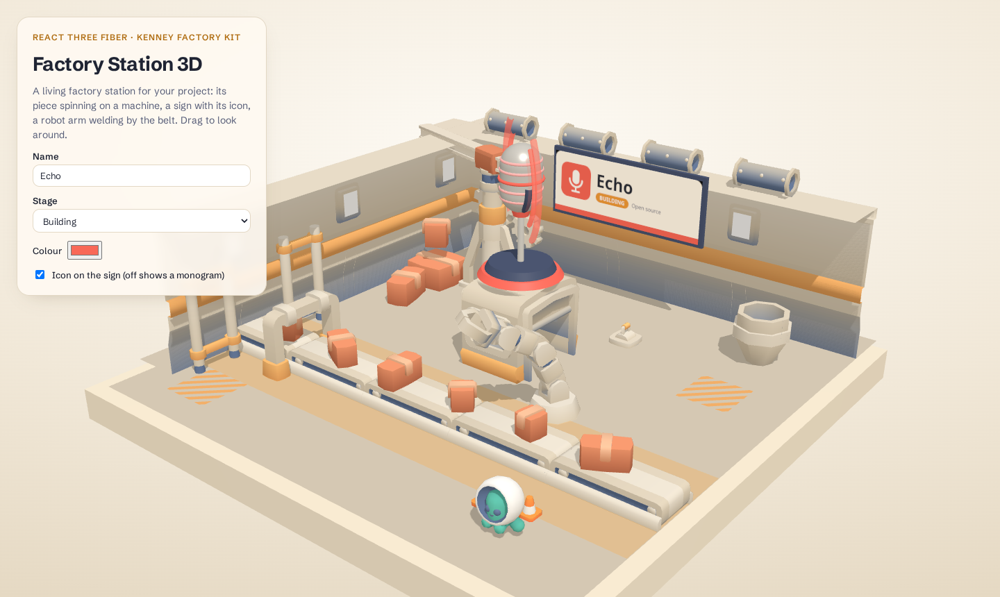

# Factory Station 3D

A living, low-poly factory station for React. Your project's piece spins on a
machine, a sign shows its icon, name and stage, a robot arm welds next to a
conveyor belt, and a cut-away workshop moves around it: boxes on the belt, a
crane, cogs on the wall and a little robot driving by.



Built with [React Three Fiber](https://r3f.docs.pmnd.rs/) and
[drei](https://drei.docs.pmnd.rs/), on top of
[Kenney's Factory Kit](https://kenney.nl/assets/factory-kit) (CC0) with a
lightened palette.

## Run the demo

```bash
pnpm install
pnpm dev
```

The demo lets you edit the project name, stage, colour and icon live.

## Use it

Copy two things into your app:

- `src/factory-station/` (the component)
- `public/models/` (the models and `Textures/colormap.png`)

Install the peer libraries:

```bash
pnpm add three @react-three/fiber @react-three/drei
```

Then render it inside a sized container:

```tsx
import { FactoryStation } from "./factory-station";

export function Showcase() {
  return (
    <div style={{ height: 600 }}>
      <FactoryStation
        project={{
          name: "Echo",
          stage: "Building",
          color: "#f86858",
          icon: "/icon.svg",
          footnote: "Open source",
        }}
        stageColor="#ef9d34"
      />
    </div>
  );
}
```

In Next.js, mark the file that renders it with `"use client"`, or load it
with `next/dynamic` and `ssr: false`.

## Props

| Prop | Type | Default | What it does |
| --- | --- | --- | --- |
| `project.name` | `string` | required | Big text on the sign. |
| `project.stage` | `string` | required | Text of the stage pill on the sign. |
| `project.color` | `string` | required | Pedestal, sign band and the default piece. |
| `project.icon` | `string` | none | Square image on the sign; without it, a monogram. SVGs need `width` and `height`. |
| `project.footnote` | `string` | none | Small text next to the stage pill. |
| `stageColor` | `string` | `#f0a23a` | Stage pill and the floor stripe under the belt. |
| `piece` | `ReactNode` | microphone | What spins on the machine. About 1.3 units tall, base at y = 0. |
| `animated` | `boolean` | on, unless `prefers-reduced-motion` | Turns every animation on or off. |
| `autoRotate` | `boolean` | `animated` | Slow orbit when nobody drags. |
| `modelsPath` | `string` | `/models/` | URL of the folder with the `.glb` files. |
| `className`, `style` | | | Passed to the canvas. |

### Your own piece

Any R3F group works as `piece`:

```tsx
<FactoryStation
  project={project}
  piece={
    <mesh position={[0, 0.6, 0]} castShadow>
      <icosahedronGeometry args={[0.5, 1]} />
      <meshStandardMaterial color="#4848e8" flatShading />
    </mesh>
  }
/>
```

## Credits and license

- Code: MIT, see [LICENSE](LICENSE).
- 3D models: [Kenney](https://www.kenney.nl), Factory Kit 3.0, CC0. The
  palette texture was recoloured; the original license is in
  [public/models/LICENSE-Kenney.txt](public/models/LICENSE-Kenney.txt).
- The demo icon is a simple drawing made for this repository.
